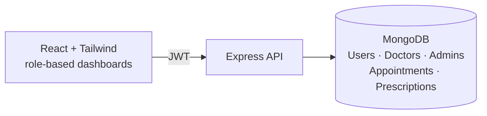

<div align="center">

# 🏥 HealthNet: Hospital Administration System

**A role-based hospital management platform for patients, doctors and admins: appointments, prescriptions and dashboards in one place.**


### [🌐 Live demo](https://health-net-efficient-hospital-administration-systems.vercel.app)

</div>

---

## ✨ Features by role

| 🧑 Patient | 🩺 Doctor | 🛡️ Admin |
|---|---|---|
| Sign up and manage profile | Manage profile | Add doctors and admins |
| See available slots | See own appointments | Total doctor and patient counts |
| **Book appointments** | **Schedule appointments** | Doctor overview |
| View appointments | View patients with appointments | Patient overview |
| View care team | **Prescribe medication** | Manage own profile |
| View prescriptions | Edit or delete prescriptions | |

- **JWT authentication** with role-based dashboards (`/patient`, `/doctor`, `/admin`)
- Passwords hashed with **bcrypt**
- Appointment status tracking: `scheduled` → `completed` / `cancelled`
- `createAdmin.js` script to bootstrap the first admin

## 🏗️ Architecture



## 📡 API overview

| Base path | Highlights |
|---|---|
| `/api/signup`, `/api/login` | Register (patients) and log in (all roles) |
| `/api/patient` | `profile`, `available-slots`, `book-appointment`, `appointments`, `care-team`, `prescriptions` |
| `/api/doctor` | `profile`, `appointments`, `patients-with-appointments`, `schedule-appointment`, `prescribe-medication`, `prescriptions/:id` |
| `/api/admin` | `add-doctor`, `add-admin`, `total-doctors`, `total-patients`, `doctor-overview`, `patient-overview` |

## 🚀 Run locally

```bash
git clone https://github.com/mayurvij22/HealthNet-Efficient-Hospital-Administration-Systems.git
cd HealthNet-Efficient-Hospital-Administration-Systems/backend
npm install
```

1. In `backend/server.js`, replace `<your_MongoDB_connection_string>` with your MongoDB URI.
2. Create the first admin and start the API:

```bash
node createAdmin.js
node server.js             # http://localhost:5000
```

3. Start the frontend:

```bash
cd ../frontend
npm install
npm start                  # http://localhost:3000
```

> [!TIP]
> For production, move the MongoDB URI and the JWT signing secret into environment variables (`.env`) instead of
> keeping them in source files.

## 🛠️ Tech stack

| Layer | Technology |
|---|---|
| Frontend | React (CRA), React Router, Tailwind CSS, lucide-react |
| Backend | Node.js, Express, Mongoose, JWT, bcrypt |
| Database | MongoDB |
| Hosting | Vercel |

---

<div align="center">

Made by **[Mayur Patil](https://github.com/mayurvij22)**

</div>
